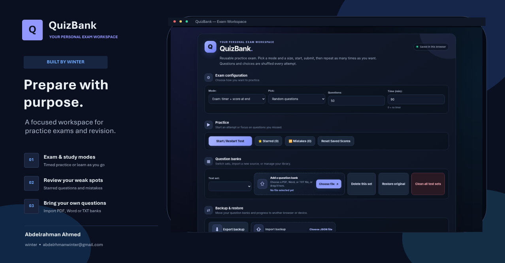

<div align="center">

# QuizBank

**Prepare with purpose.** A focused, private workspace for practice exams and revision — import your own questions, build reusable tests, and track your progress. No server, no sign-up, no build step.



</div>

---

## Features

- **Bring your own questions** — import a **PDF, Word (.docx) or TXT** file (click or drag & drop). Questions and options are extracted automatically.
- **Review before saving** — a review screen shows everything that was detected. Tick the correct answers, rename the set, and choose a range (e.g. *first 10*, *first 20*, or *from 15 to 40*).
- **Two practice modes**
  - **Exam** — countdown timer, score at the end, auto-submit when time runs out.
  - **Study** — the correct answer is revealed right after each question.
- **Flexible test size** — random questions, first N in file order, or first N shuffled. Questions *and* answer choices are shuffled on every attempt.
- **⭐ Starred** — mark difficult questions and revisit them on one page.
- **🔁 Mistakes** — every question you get wrong is collected automatically and removed once you answer it correctly. You can also retry only the questions you missed in the last attempt.
- **Multiple question banks** — keep as many sets as you like and switch between them.
- **Backup & restore** — export everything to a JSON file and merge it back on any browser or device.
- **Arabic / English** — switch the whole interface with one click (full RTL support).
- **Light / Dark theme** — icon toggle with a smooth transition; your choice is remembered.
- **Clear feedback** — color-coded messages (blue = working, green = success, amber = warning, red = error) and automatic scrolling to the start of the test or the review screen.
- **Private by design** — everything is stored in your browser's `localStorage`. Nothing is uploaded anywhere.

## Getting started

QuizBank is a single HTML file.

**Run it locally**

1. Download `index.html` (or the `QuizBank_Winter_Production_Release.html` file).
2. Open it in any modern browser.

**Host it on GitHub Pages**

1. Rename the HTML file to `index.html` and push it to your repository.
2. Go to **Settings → Pages**, choose your branch and the root folder, and save.
3. Open `https://<your-username>.github.io/<repository>/`.

## How to use

1. **Add a question bank** — choose a file in *Question banks*. Check the detected questions and correct answers, then press **Save test set**.
2. **Configure your exam** — pick the mode, how questions are chosen, how many, and the time limit (`0` = no timer; the default is 1.8 minutes per question).
3. **Start** — press **Start / Restart Test**. The page scrolls to the beginning of the test.
4. **Review** — see your score, the questions you missed, and retry only the wrong ones.

### Supported question format

The importer works best with this layout:

```text
Question 1: Which protocol does a SOAP web service commonly use?
A) FTP
B) HTTP
C) SMTP only
D) None of these
Answer: B

Question 2: Which TWO are valid options?
A) Option one
B) Option two
C) Option three
D) Option four
Answer: A, C
```

- A question can start with `Question N:`, `QN`, `N.` or `N)`.
- Options can start with `A)`, `B.`, or a bullet/circle (`•`, `○`, `●`, `-`).
- The correct answer is detected from a line like `Answer: B` / `Answer: A, C`, a ✓ / ● marker before the option, or a `(correct)` / `*` suffix.
- If no answer is marked, you simply tick it on the review screen — questions without a correct answer are skipped.

> **Tip:** the page includes a ready-made **prompt** (at the bottom). Paste it into any AI assistant (ChatGPT, Claude, Gemini…) together with your questions to convert them into exactly this format, then save the result as `.txt` or `.docx` and import it.

## Good to know

- **Your data stays in your browser.** Imported tests, stars, mistakes and scores live on the same browser and device only. Use **Export backup** to move them elsewhere, and export before pressing **Clear all data**.
- **PDF and Word import needs internet the first time.** The readers ([pdf.js](https://mozilla.github.io/pdf.js/) and [mammoth.js](https://github.com/mwilliamson/mammoth.js)) are loaded from a CDN. TXT import works fully offline.
- **Scanned PDFs are not supported** — they contain images, not text.
- Unusual file formatting can split a question incorrectly; that is why the review screen exists.

## Tech stack

Plain HTML, CSS and JavaScript — no framework, no build tooling, no backend.

| Purpose | Library |
| --- | --- |
| PDF text extraction | [pdf.js](https://mozilla.github.io/pdf.js/) |
| Word (.docx) text extraction | [mammoth.js](https://github.com/mwilliamson/mammoth.js) |

## Project structure

```text
.
├── index.html     # the whole application
├── preview.png    # screenshot used in this README
└── README.md
```

## Author

**Abdelrahman Ahmed** (*winter*)
[abdelrhmanwinter@gmail.com](mailto:abdelrhmanwinter@gmail.com) · [GitHub](https://github.com/Abdelrhman-Winter)

---

<div dir="rtl">

## نبذة سريعة (عربي)

**QuizBank** مساحة مذاكرة شخصية تعمل بالكامل داخل المتصفح: استورد أسئلتك من ملف PDF أو Word أو TXT، راجع الأسئلة المستخرجة، ثم تدرّب بوضع الامتحان (عدّاد + نتيجة في النهاية) أو وضع المذاكرة (الإجابة بعد كل سؤال). يمكنك تعليم الأسئلة الصعبة بـ ⭐، ومراجعة أخطائك تلقائيًا، وأخذ نسخة احتياطية من بياناتك، والتبديل بين العربية والإنجليزية وبين الوضع الفاتح والداكن. كل بياناتك تبقى في متصفحك ولا تُرفع إلى أي مكان.

</div>
